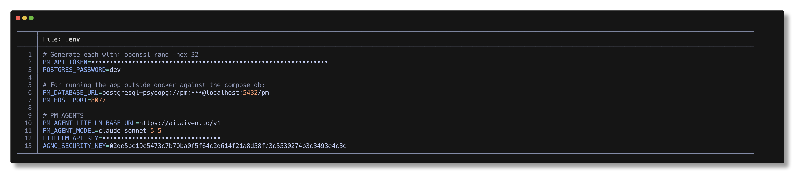

# nvim-secrets



Masks secrets and keys in Neovim buffers. Masking is display-only: the buffer text never changes, so yanking and saving still use the real value. Secrets are masked in normal and visual mode. In insert and replace mode only the line under the cursor is shown by default; set `reveal_scope = "all"` to show the whole buffer instead.

It also ships a `bat-secrets` command, so the same detection masks what [bat](https://github.com/sharkdp/bat) prints. See [Use with bat](#use-with-bat).

## What this is not

This plugin hides secrets on screen, for example during a screen share or a recording. It does not stop you leaking secrets in code. Detection is best-effort, a secret can show up before the first scan finishes, and the buffer text and anything you save, yank or commit are untouched.

To keep secrets out of your repos, run the scanners it depends on yourself, such as in a pre-commit hook or in CI:

```sh
ripsecrets                          # scan the working tree
betterleaks dir .                   # scan the working tree
betterleaks git .                   # scan a repo's history
```

## Detection backends

Pick any combination with `backends`:

| Backend       | What it is                                                                                                                          | Runs                       |
| ------------- | ----------------------------------------------------------------------------------------------------------------------------------- | -------------------------- |
| `lua`         | Built-in regexes (known token formats, `key = value` assignments, URI passwords, PEM private keys, entropy check). No dependencies. | Instantly, on every redraw |
| `ripsecrets`  | [ripsecrets](https://github.com/sirwart/ripsecrets). Fast, few false positives, only reports random-looking values.                 | Async, after changes       |
| `betterleaks` | [betterleaks](https://github.com/betterleaks/betterleaks). Large rule set.                                                          | Async, after changes       |

External scanners run on `BufEnter`, `TextChanged` and `InsertLeave`, after `scan_delay` ms. Their findings are masked by value, so every copy of a reported secret is hidden and masks survive edits made before the next scan finishes. A missing binary produces one warning and is skipped.

The plugin never passes `--validate` or `--analyze` to betterleaks, so nothing is sent to a provider. Because ripsecrets can't read stdin, the buffer is written to Neovim's private temp directory for the scan and deleted straight after.

## Adding custom patterns to the lua backend

The lua backend has no config option for patterns yet. Its rules live in [`lua/secrets/detect.lua`](lua/secrets/detect.lua), so to add one you edit that file (use `dir = "~/nvim-secrets"` or a fork, see Install).

To mask a token with a distinctive prefix, add an entry to `token_patterns`:

```lua
local token_patterns = {
  -- ...
  { name = "acme-token", pat = [=[\v<acme_[A-Za-z0-9]{32}>]=] },
}
```

- `name` is a label for the rule. It isn't used for matching.
- `pat` is a Vim regex, compiled with `vim.regex`. Start it with `\v` for "very magic" syntax, and wrap it in `[=[ ... ]=]` so backslashes need no escaping.
- Everything the pattern matches is masked. To mask only part of a match, bracket it with `\zs` and `\ze`. The built-in `uri-password` rule does this to hide the password and leave the URL readable.
- Use `<` and `>` to anchor word boundaries, so the pattern doesn't fire inside longer strings.

The other rules in the same file:

- `assignment_pat` masks the value in `secret = value` style lines. Add a keyword to its list to cover another name, such as `signing[_-]?key`.
- `entropy_pat` and the `entropy_threshold` option control the high-entropy string check.
- `placeholders` lists values that are never masked.

Add a case to `tests/detect_spec.lua` and run it:

```lua
check("key = acme_" .. string.rep("aB3d", 8), { "acme_" .. string.rep("aB3d", 8) })
```

```sh
nvim -l tests/detect_spec.lua
nvim --clean -l tests/bat_spec.lua
```

If you'd rather not edit Lua, the `ripsecrets` and `betterleaks` backends bring their own rule sets. See each project's docs for custom rules.

## Install

lazy.nvim:

```lua
{
  "kjaymiller/nvim-secrets",
  event = "VeryLazy",
  opts = {
    backends = { "lua", "betterleaks" },
  },
}
```

For local development, use `dir = "~/nvim-secrets"` in place of the repo name.

Install the scanners you want, for example `brew install ripsecrets betterleaks`.

## Use with bat

`bin/bat-secrets` runs bat with secrets masked, using the same `detect.lua` patterns and scanners as the plugin, so a pattern added once works in both. It needs `nvim` and `bat` on your PATH.

```sh
ln -s ~/nvim-secrets/bin/bat-secrets ~/.local/bin/bat-secrets
bat-secrets .env                    # any bat options and files work
echo 'token = abc123def456' | bat-secrets -l ini
alias bat=bat-secrets               # optional
```

bat has no plugin API, so the text is masked before it reaches bat. Highlighting, paging and decorations are unchanged, and the file on disk is never touched. Each secret becomes `mask_char` characters of the same display width, so columns stay aligned. `--version`, `--list-themes` and the other bat modes that don't show files pass straight through.

| Flag                         | Env                         | Default                                                               |
| ---------------------------- | --------------------------- | --------------------------------------------------------------------- |
| `--backends lua,betterleaks` | `BAT_SECRETS_BACKENDS`      | `lua`                                                                 |
| `--mask-char •`              | `BAT_SECRETS_MASK_CHAR`     | `•`                                                                   |
| `--no-entropy`               |                             | entropy check on                                                      |
| `--entropy-threshold 4.0`    |                             | `4.0`                                                                 |
| `--reveal`                   | `BAT_SECRETS=0`             | masking on                                                            |
|                              | `BAT_SECRETS_<BACKEND>_CMD` | scanner path, e.g. `BAT_SECRETS_BETTERLEAKS_CMD=/opt/bin/betterleaks` |
|                              | `BAT_SECRETS_BAT`           | `bat`                                                                 |

`bat-secrets --secrets-help` lists them. The scanners run once per file, in the foreground, before bat starts. The plugin's other options (`reveal_*`, `scan_delay`, `disabled_filetypes`) only apply inside Neovim.

## Options

```lua
{
  enabled = true,
  mask_char = "•",
  hl_group = "Comment",
  reveal_cursorline = false,  -- show real text on the cursor line
  reveal_modes = { "i", "R" }, -- modes (first character) that show real text
  reveal_scope = "line",      -- "line": cursor line only, "all": whole buffer
  backends = { "lua" },       -- "lua", "ripsecrets", "betterleaks"
  commands = {},              -- e.g. { betterleaks = "/opt/bin/betterleaks" }
  scan_delay = 150,           -- ms after a change before an external scan
  entropy = true,             -- flag high-entropy quoted strings (lua backend)
  entropy_threshold = 4.0,
  max_lines = 20000,          -- skip private-key block scanning above this
  disabled_filetypes = {},
}
```

## Commands

- `:SecretsEnable`, `:SecretsDisable`, `:SecretsToggle`
- `:SecretsToggleBuffer` — toggle for the current buffer only

## Limits

- The lua backend masks per line, apart from PEM private key blocks.
- Its entropy check will occasionally flag hashes or IDs.
- Values only get masked by external scanners once the first scan returns.

## Tests

```sh
nvim -l tests/detect_spec.lua
nvim --clean -l tests/bat_spec.lua
```
